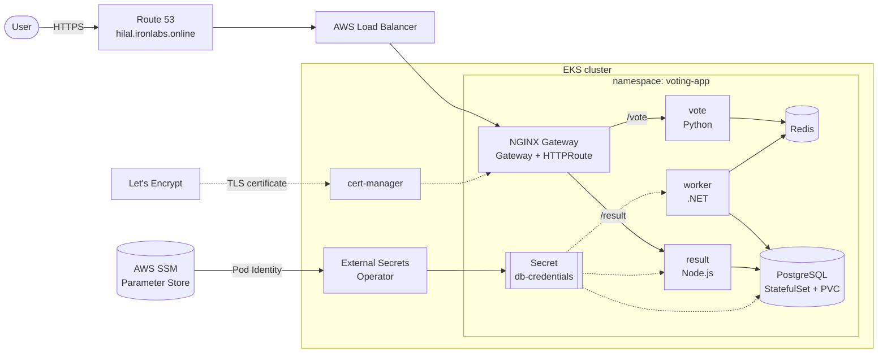
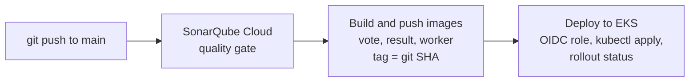

# Voting App on Amazon EKS


[](https://sonarcloud.io/summary/new_code?id=huluc_voting-app-eks)

A microservices voting app (Python, Node.js, .NET, Redis, PostgreSQL) running on Amazon EKS,
with a GitHub Actions pipeline that scans, builds and deploys every change automatically.

Ironhack DevOps & Cloud Computing bootcamp, Project 2.

**Live (during the course):** https://hilal.ironlabs.online/vote and https://hilal.ironlabs.online/result/

## Highlights

- **Gateway API** with NGINX Gateway Fabric instead of the retired ingress-nginx
- **HTTPS** with cert-manager and Let's Encrypt, on a custom domain in Route 53
- **No AWS keys in GitHub:** the pipeline signs in to AWS with **OIDC** and a short-lived role
- **External Secrets Operator:** the DB password lives only in AWS SSM Parameter Store
- **Least privilege:** the pipeline can only edit the `voting-app` namespace
- **SonarQube Cloud quality gate** before every build
- **PostgreSQL as a StatefulSet** with a persistent volume (data survives pod restarts)
- **Readiness/liveness probes and resource limits** on every workload

## Architecture



How a vote travels: **vote → Redis → worker → PostgreSQL → result**.

## CI/CD pipeline



| Job | What it does |
|---|---|
| SonarQube scan | Scans the code; the pipeline stops if the quality gate fails |
| Build and push (matrix) | Builds the three images in parallel and pushes them to Docker Hub, tagged with the commit SHA |
| Deploy to EKS | Assumes an IAM role with OIDC, updates the image tags, runs `kubectl apply` and waits for the rollout |

Pull requests only run the scan. Build and deploy run only on `main`, inside the `production` GitHub Environment.

**Secrets in GitHub:** only `DOCKERHUB_TOKEN` and `SONAR_TOKEN`. There are no AWS credentials;
the role ARN is a normal variable.

## Platform vs. application

| | `scripts/bootstrap.sh` (platform) | Pipeline (application) |
|---|---|---|
| When | Once, after the cluster is created | On every push to `main` |
| Installs | Gateway API CRDs, NGINX Gateway Fabric, External Secrets Operator, cert-manager, namespace, Gateway, HTTPRoute, DNS record, pipeline access | Deployments, Services, StatefulSet |
| Folder | `k8s/platform/` | `k8s/app/` |

The script is idempotent: running it again only applies what changed.

## Security

| Topic | How |
|---|---|
| Pipeline → AWS | GitHub OIDC. The IAM role trusts only `repo:huluc@40721928/voting-app-eks@1430828147:environment:production` (immutable owner and repo IDs) |
| Pipeline permissions | IAM: only `eks:DescribeCluster` on this cluster. Kubernetes: `AmazonEKSEditPolicy` scoped to the `voting-app` namespace |
| DB password | Stored as a SecureString in SSM. External Secrets Operator reads it with its own IAM role (Pod Identity), limited to `/voting-app/hilal/*` |
| Traffic | HTTPS terminated at the Gateway with a Let's Encrypt certificate (HTTP-01 challenge) |
| Code quality | SonarQube Cloud quality gate; vendored minified libraries are excluded |

## Repository structure

```text
.
├── .github/workflows/ci-cd.yml   # scan → build → deploy
├── infra/iam/                    # IAM trust and permission policies (GitHub Actions, ESO)
├── k8s/
│   ├── app/                      # applied by the pipeline
│   │   ├── db.yaml               # PostgreSQL StatefulSet + headless Service
│   │   ├── redis.yaml
│   │   ├── vote.yaml
│   │   ├── result.yaml
│   │   └── worker.yaml
│   └── platform/                 # applied by bootstrap.sh
│       ├── crds/gateway-api.yaml # vendored Gateway API CRDs
│       ├── namespace.yaml
│       ├── gateway.yaml          # HTTP + HTTPS listeners
│       ├── httproute.yaml        # /vote → vote, /result → result
│       ├── external-secrets.yaml # SecretStore + ExternalSecret
│       ├── cluster-issuers.yaml  # Let's Encrypt staging + production
│       └── cert-manager-values.yaml
├── scripts/bootstrap.sh
├── sonar-project.properties
├── vote/  result/  worker/       # application source and Dockerfiles
└── docker-compose.yml            # local run with Docker Compose
```

## Run it yourself

**One-time setup (AWS account):**
- IAM role for GitHub Actions from `infra/iam/trust-policy.json` and `permissions-policy.json`
- IAM role for External Secrets Operator from `infra/iam/eso-*.json`
- DB password in SSM: `aws ssm put-parameter --name /voting-app/hilal/db-password --type SecureString --value '<password>'`
- GitHub Environment `production` with `AWS_ROLE_ARN`, `AWS_REGION`, `EKS_CLUSTER_NAME`, `DOCKERHUB_USERNAME` and the secret `DOCKERHUB_TOKEN`; repository secret `SONAR_TOKEN`

**Every time:**
1. Create the cluster with [eks-quick-terraform](https://github.com/professordiogodev/eks-quick-terraform): `./up.sh <name>`
2. Prepare it: `./scripts/bootstrap.sh`
3. Deploy: push to `main`, or run the workflow manually (**Actions → CI/CD → Run workflow**)
4. Open `https://hilal.ironlabs.online/vote`
5. Clean up: `./down.sh <name>`

## Problems solved along the way

| Problem | Cause | Fix |
|---|---|---|
| vote crashed with `invalid literal for int(): 'tcp://…:6379'` | Kubernetes injects `REDIS_PORT=tcp://…` for every Service named `redis`; the app expected a number | `enableServiceLinks: false` on the pods |
| Gateway returned `504` / empty response | The EKS module only allows node-to-node traffic on ports 1025–65535; the apps and NGINX listen on port 80 | Added a node-to-node rule in the cluster Terraform (below) |
| Pipeline: `Not authorized to perform sts:AssumeRoleWithWebIdentity` | GitHub's OIDC subject contains immutable IDs (`huluc@40721928/…`); the trust policy expected the plain name | Found the real subject in CloudTrail; matched it exactly and restricted the role to the `production` environment |
| `bootstrap.sh` timed out downloading CRDs from GitHub | Slow network during `kubectl kustomize <url>` | Vendored the CRDs in the repo |

Node-to-node rule added to `main.tf` of eks-quick-terraform:

```hcl
node_security_group_additional_rules = {
  ingress_self_all = {
    description = "Node to node all ports/protocols"
    protocol    = "-1"
    from_port   = 0
    to_port     = 0
    type        = "ingress"
    self        = true
  }
}
```

## Next steps

- Build only the services that changed (path filters)
- Move the HTTPRoute to the app manifests and give the pipeline access to it
- NetworkPolicy so only vote and worker can reach Redis, and only worker and result can reach PostgreSQL
- Password for Redis
- GitOps (Argo CD or Flux) instead of `kubectl apply` from the pipeline

## Credits

- Application code: Ironhack course repository ([Pokfinner/ironhack-project-1](https://github.com/Pokfinner/ironhack-project-1))
- Cluster: [eks-quick-terraform](https://github.com/professordiogodev/eks-quick-terraform) by the course instructor, plus the node-to-node security group rule above
